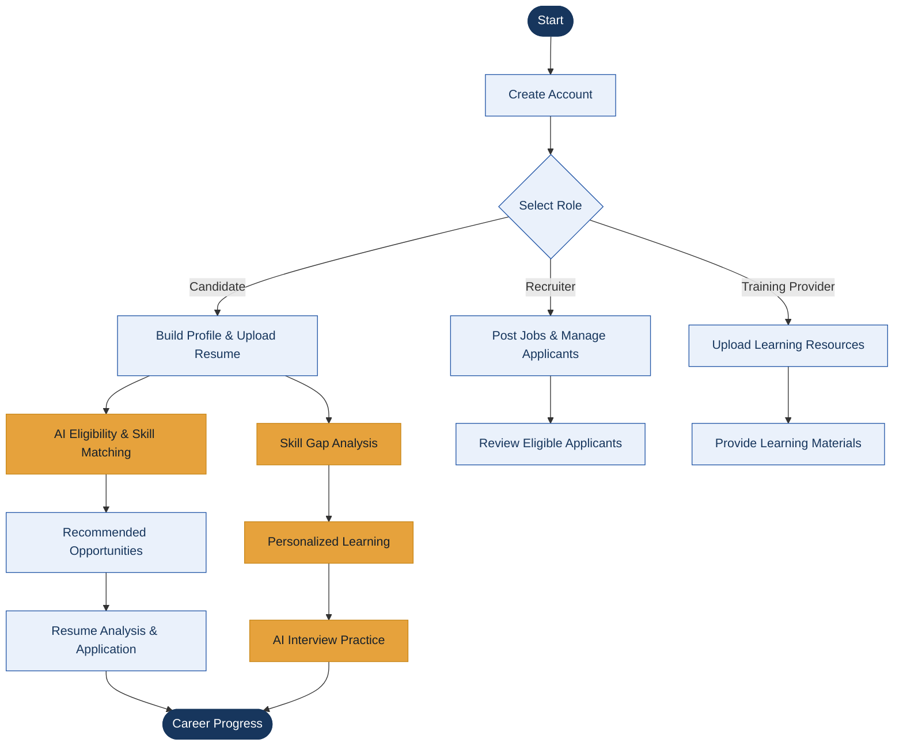
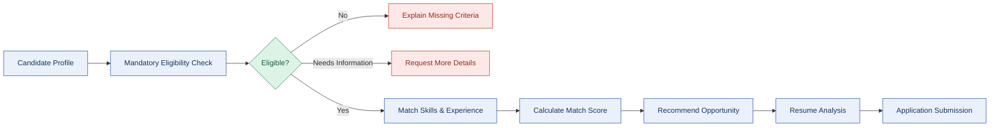
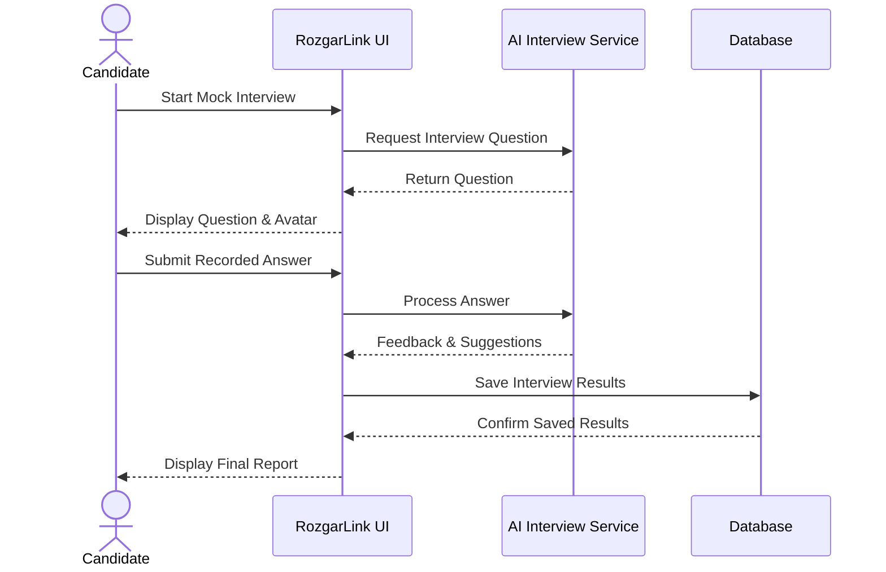

# 🚀 RozgarLink
### AI-Powered Career Development & Employment Platform

RozgarLink connects **job seekers, recruiters, and training providers** through a unified platform for job discovery, resume improvement, skill development, and AI-powered interview preparation.

<p align="center">
  
  
  
  
</p>

---

## ✨ Key Features

- 🎯 **AI Job Matching** — Match candidates with opportunities based on eligibility and skills.
- 📄 **Resume Studio** — Analyze resumes and assist with tailored resume creation.
- 🤖 **AI Career Assistant** — Get personalized career guidance.
- 📚 **AI Tutor** — Access AI-powered learning assistance.
- 🎤 **AI Interview Coach** — Practice interviews and receive feedback.
- 📊 **Skill Gap Analysis** — Identify missing skills and discover learning resources.
- 🏢 **Recruiter Dashboard** — Manage job postings and applicants.
- 🎓 **Training Provider Workspace** — Manage learning materials and resources.

## 🧭 How RozgarLink Works



## 🔄 AI Job Matching Workflow



## 🎤 AI Interview Preparation Flow



## 🛠️ Tech Stack

| Layer | Technologies |
|---|---|
| Frontend | Next.js, React, TypeScript, Tailwind CSS |
| Backend | Node.js, Express.js |
| Database | MongoDB |
| AI Features | AI-powered career assistance, learning, and interview preparation |
| Visualization | Mermaid diagrams |

## 📂 Project Structure

```text
RozgarLink/
├── backend/
│   ├── controllers/
│   ├── middlewares/
│   ├── models/
│   ├── routes/
│   └── services/
├── frontend/
│   ├── app/
│   ├── components/
│   ├── lib/
│   └── public/
└── README.md
```

## ⚙️ Getting Started

### 1. Clone the Repository

```bash
git clone https://github.com/AnushkaaKulkarni/npm-install-aura.git
cd npm-install-aura
```

### 2. Install Dependencies

```bash
cd backend
npm install
```

In a separate terminal:

```bash
cd frontend
npm install
```

### 3. Configure Environment Variables

Create the required `.env` files using the project's environment examples. Configure database connections and any required AI service credentials.

**Security:** Never commit API keys, passwords, or secret environment files to GitHub.

### 4. Run the Application

Start the backend and frontend using the development scripts defined in their respective `package.json` files.

## 🌟 Project Goal

RozgarLink aims to simplify career development by bringing **employment opportunities, resume improvement, skill development, and interview preparation** together in one AI-powered platform.

---

<p align="center">
  <b>RozgarLink — Connecting Skills, Opportunities & Careers.</b>
</p>
